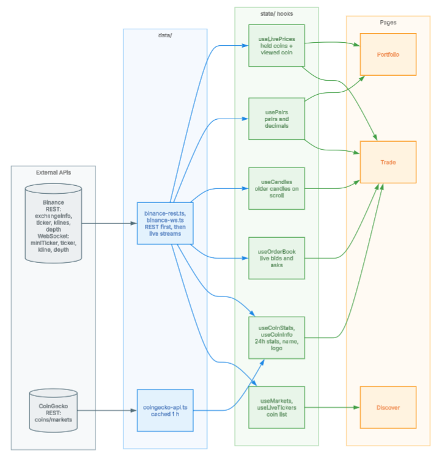
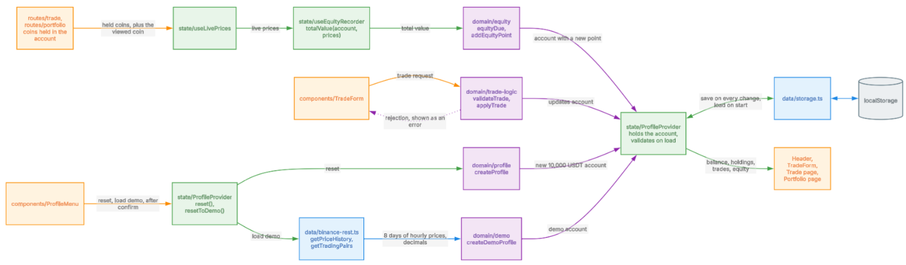
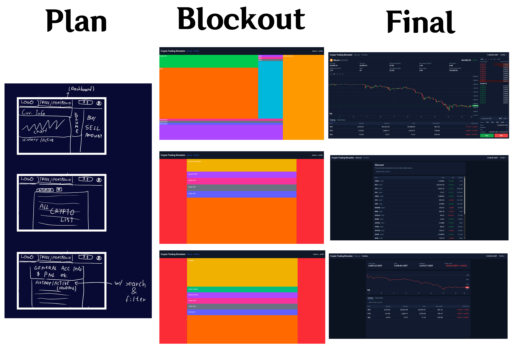

# Crypto Trading Simulator

Browser-only crypto trading simulator: virtual money, 10,000 USDT starting balance, live Binance prices, account saved in `localStorage`.

**Stack:** TypeScript (strict), React 19, React Router 8 (SPA mode), Vite, Tailwind CSS 4, Lightweight Charts.

**Demo:** screenshots and video in [`demo/`](demo/).

## ⚠️ Heavy AI tool usage

I built this with heavy use of an AI coding assistant (Claude Code), since doing this scope on my own within the time limit would've been above my current skill level. It wrote most of the code. I broke the work into small tasks, decided how things should behave, reviewed what it gave me and a lot of the design and structure decisions came from my own requests. It was most helpful with anything that needed specific knowledge of external libraries and APIs, but it wasn't perfect. It sometimes gave confident wrong answers, guessed how APIs work instead of checking the docs, leaned towards generic styling and added things I didn't ask for, so everything needed reviewing.

## Design differences from the task

- **Dashboard:** there's no single dashboard page. The account summary and holdings are on Portfolio, the list of all coins is on Discover and the cash balance is in the header on every page.
- **Trade history:** a tab next to Holdings on the Portfolio and Trade pages, not a separate page.
- **Crypto decimals:** quantities use each coin's step size from Binance (e.g. 5 decimals for BTC) instead of a fixed 6–8.

## Getting started

Requires Node.js 22.22+.

```bash
npm install
npm run dev        # http://localhost:5173
```

| Script              | Runs                        |
| ------------------- | --------------------------- |
| `npm run build`     | Production build            |
| `npm start`         | Serves the production build |
| `npm run typecheck` | Route types and `tsc`       |

Full setup, checks and manual testing steps: [`SKILL.md`](SKILL.md).

## Architecture

Layers: `routes/` and `components/` render, `state/` holds hooks and contexts, `data/` talks to APIs and storage, `domain/` holds pure rules.

```
app/
├── root.tsx                  App shell, providers, error page
├── routes.ts                 Route table
├── theme.css                 Light/dark color tokens
├── app.css                   Global styles
├── routes/
│   ├── discover.tsx          Coin list page (/)
│   ├── portfolio.tsx         Portfolio page (/portfolio)
│   └── trade.tsx             Coin trade page (/trade/:coin)
├── components/
│   ├── layout/
│   │   ├── Header.tsx        Title, navigation, cash balance
│   │   └── ProfileMenu.tsx   Reset, demo, theme, language
│   ├── market/
│   │   ├── CoinList.tsx      All pairs, live rows
│   │   ├── CoinDetails.tsx   Coin stats and info
│   │   ├── PriceChart.tsx    Candlestick chart, timeframes
│   │   └── OrderBook.tsx     Live bids and asks
│   ├── portfolio/
│   │   ├── PortfolioSummary.tsx   Total, cash, holdings, P/L
│   │   ├── EquityChart.tsx        Account value over time
│   │   ├── PortfolioPanel.tsx     Holdings/history tabs, search, filter
│   │   ├── PortfolioTabs.tsx      Tab buttons
│   │   ├── HoldingsList.tsx       Owned coins with P/L
│   │   └── TradeHistory.tsx       Past trades table
│   ├── trade/
│   │   ├── TradeForm.tsx     Buy/sell form
│   │   └── QuickAmounts.tsx  Owned % buttons
│   └── ui/
│       ├── Table.tsx         Table, cells, clickable rows
│       ├── Pagination.tsx    Page buttons, page jump
│       ├── SegmentedControl.tsx   Single-choice buttons
│       ├── SearchBox.tsx     Coin search input
│       ├── Stat.tsx          Label and value
│       ├── Notice.tsx        Loading/empty text
│       ├── ErrorMessage.tsx  Error with Retry
│       └── ReconnectingNote.tsx   Reconnecting notice
├── state/
│   ├── store.tsx             Account context, saving, reset, demo
│   ├── theme.tsx             Light/dark theme
│   ├── live-prices.ts        Live prices of given coins
│   ├── pairs.ts              Tradable pairs and decimals
│   ├── markets.ts            Coin list, live tickers
│   ├── coin.ts               Coin stats and info
│   ├── order-book.ts         Live order book
│   ├── candles.ts            Candles, live and older
│   ├── equity.ts             Equity point recording
│   └── presets.ts            Saved % buttons
├── data/
│   ├── binance-rest.ts       Binance REST requests, types
│   ├── binance-ws.ts         Binance streams, order book sync
│   ├── coingecko-api.ts      Coin info
│   ├── http.ts               fetch with typed errors
│   └── storage.ts            Versioned localStorage, cache
├── domain/
│   ├── profile.ts            Account types, value, P/L
│   ├── trade-logic.ts        Fees, validation, applying trades
│   ├── equity.ts             Equity points, even time grid
│   ├── order-book.ts         Price level grouping
│   └── demo.ts               Demo account trades
├── i18n/
│   ├── en.ts                 English text
│   ├── bg.ts                 Bulgarian text
│   └── language.tsx          Language context, text hooks
└── utils/
    ├── format.ts             Number and date formatting
    ├── amount.ts             Typed amount parsing
    ├── chart.ts              Shared chart options
    ├── pagination.ts         Paging hook, page numbers
    ├── paths.ts              Trade page links
    └── search.ts             Coin name matching
```

**State management:** React Context with providers, because that's what I have experience with.

- **Account** (balance, holdings, trades, equity curve): one React context in `state/store.tsx`, saved to `localStorage` on every change.
- **Corrupt or outdated saves:** replaced with a new 10,000 USDT account.
- **Trades:** applied by pure functions in `domain/trade-logic.ts`.
- **Market data:** one hook per view in `state/`. Each loads over REST, then subscribes to a WebSocket and returns `error`, `retry` and `live`.

Things definitely changed as I was doing them. Due to the time limit I focused on making things work first, then refining them later. This is definitely not the optimal way of working, because it caused rewrites and file renames as I figured out how things should connect. If I had more time, I would have spent a lot longer planning how the app should be structured, instead of building the features piece by piece, then connecting and refactoring them.

**Data flow: market data**



Live market data flows left to right. The `data/` layer requests the initial data from Binance's REST API, then keeps it live through WebSocket streams. Coin names and logos come from CoinGecko, cached for an hour. Each `state/` hook holds one kind of data, with its loading, error and connection status and the pages only render what the hooks return.

**Data flow: account updates**



Every change to the account ends in `ProfileProvider`. Live prices of the held coins add equity points through `useEquityRecorder`. A trade is checked by `validateTrade` and applied by `applyTrade`. A reset creates a new 10,000 USDT account and the demo account is built from Binance's hourly prices. The provider saves each change to `localStorage`, validates the saved account on start and passes the account to the pages.

Colors: grey = external, blue = `data/`, green = `state/`, purple = `domain/`, orange = UI. Each arrow has the color of the layer it comes from.

## Where prices come from

I used the Binance public API (REST and WebSocket) as the source for all prices and market data, because I prefer the app to be in a usable and realistic state with accurate info. CoinGecko is only used for display: the coins' names and icons, plus a few extra stats on the trade page (market cap, rank, supply).

## Styling

Tailwind CSS. I built the layout blockout by hand with Tailwind because it's quick to iterate with. Visual design wasn't the focus of this task, so I prioritised functionality and structure and generated the color theme with AI.

## Known limitations

- **Fills:** trades fill at the last price. There are no order book fills, slippage or limit orders.
- **Equity curve:** recorded only while the app is open.
- **Storage:** `localStorage` is limited to about 5 MB.
- **Mobile:** the trade page's coin header overflows and the portfolio summary wraps. Ideally there'd be conditional rendering by resolution for the different components and layout, to make it as accessible as possible on mobile. I chose to leave it as it is so I didn't complicate that part.
- **Tests:** tested manually; there are no automated unit tests.

## What I'd do with more time

With more time I would look for alternative solutions to what I'm doing, to decide whether the way I'm approaching the problem is the best one. This requires more domain (crypto) knowledge, as well as knowledge of the specific external libraries and APIs used (Binance and the charts). For this assignment I focused on making things work.

## Reflection

### What was hardest and how I approached it

It's difficult to say what the hardest part was, considering the heavy use of AI mentioned above, which made things significantly easier. I'd say the most interesting part was thinking of ways to limit unnecessary web and API calls to Binance, to optimise the application for use by many people. The price chart was also interesting because I wanted to limit the calls there as well. Instead of fetching all the candles at once and putting load on the server, it only loads and displays what the user sees, fetching older candles as they scroll.

### Decisions I'd change in hindsight

Make trades fill orders from the order book instead of executing at the current price. I think this would have the biggest impact on actual usability as a trading application, because the prices would be more accurate. I wanted to introduce things like slippage as well, because I think these are essential to making an actual trading application, but I didn't want to complicate it any further as the app was already getting quite large.

## Demo

Screenshots: [`demo/`](demo/)

### Progress: plan, blockout, final



## Credits

The charts are made with [TradingView Lightweight Charts™](https://www.tradingview.com/lightweight-charts/), licensed under the Apache License 2.0.

TradingView Lightweight Charts™<br>
Copyright (c) 2025 TradingView, Inc. <https://www.tradingview.com/>
